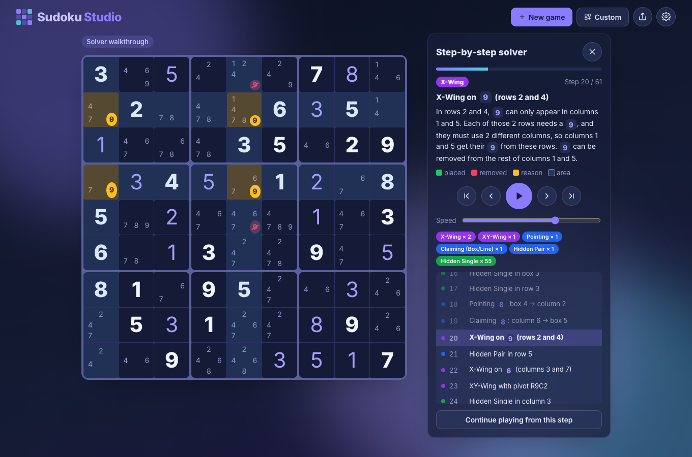
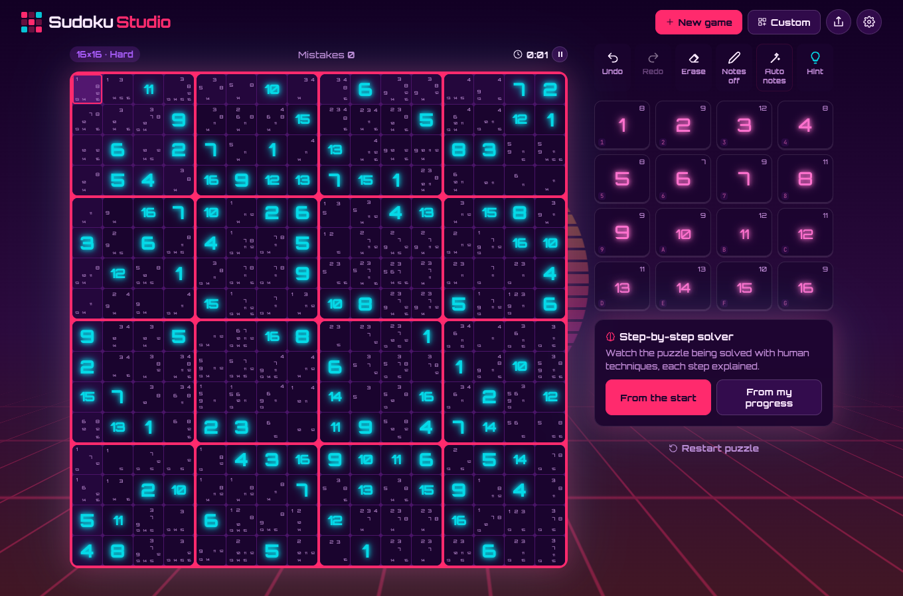

# Sudoku Studio

A themeable sudoku game for the browser. It plays on **any board size** (4×4 up to 16×16), and its
**step-by-step solver** shows how a person would solve the puzzle, one technique at a time.



## Features

- **Six board sizes** built from rectangular boxes: 4×4, 6×6, 8×8, 9×9, 12×12 and 16×16.
- **Puzzle generator** with Easy / Medium / Hard / Expert ratings. Each rating is set by the hardest
  technique the puzzle needs, and every puzzle has exactly one solution.
- **Step-by-step solver** with 14 human techniques: Hidden & Naked Singles, Pointing, Claiming,
  Naked Pair/Triple/Quad, Hidden Pair/Triple, X-Wing, Swordfish, Jellyfish, XY-Wing and XYZ-Wing.
  When none of these apply, it falls back to an explained trial step.
  - Every step highlights the area, the cells that cause the deduction, the candidates it removes
    (struck out in red) and the value it places (green).
  - Walkthrough has a timeline, autoplay, speed control, and "continue playing from this step".
- **Hints in three tiers**: technique name → where to look → apply. A hint also catches mistakes
  before giving advice.
- **8 themes** (Classic Paper, Midnight, Neon Synthwave, Forest, Ocean, Candy, Terminal, High Contrast),
  each with its own animated background.
- **8 symbol sets**: numbers, alphanumeric, letters, Greek, fruit 🍎, animals 🐶, space 🪐 and colors.
- Pencil notes, auto-notes, undo/redo, mistake tracking, timer and pause, keyboard support,
  mobile layout, and auto-save to `localStorage`.
- **Custom puzzles**: type or paste your own puzzle. The game checks that it has exactly one
  solution, rates its difficulty, and lets you play it or watch it solved.
- **Share links**: the puzzle is encoded in the URL hash.



## Development

```bash
npm install
npm run dev        # start the dev server
npm test           # engine, solver, generator and reducer tests
npm run build      # type-check and build to dist/
npm run preview    # serve the production build
```

## Deploying to GitHub Pages

The workflow in `.github/workflows/deploy.yml` tests, builds and deploys on every push to `main`.

1. Create a GitHub repository and push this project to it.
2. In the repository, open **Settings → Pages** and set **Source** to **GitHub Actions**.
3. Push to `main`. The site is published at `https://<user>.github.io/<repo>/`.

`vite.config.ts` uses `base: './'`, so the build works from any sub-path without extra configuration.

## Architecture

```
src/
  engine/     pure TypeScript: geometry for any box shape, bitmask candidates,
              brute-force search, generator, serialization
  solver/     techniques (one file per family), logical solver, difficulty grading
  workers/    Web Worker that runs generate / analyze / solve off the main thread
  themes/     data-only themes (CSS variables + effect) and symbol sets
  state/      game reducer (notes, undo/redo, hints), settings and persistence
  ui/         React components
  styles/     base, board and background-effect CSS
```

Each technique is a pure function from the board state to a `Step`. A step holds its placements,
eliminations, highlights and an explanation in which values are written as `{v}` tokens, so the UI
can render them in any symbol set. To add a technique, write a new file in `src/solver/techniques/`
and register it in `index.ts`. To add a theme, add one object in `src/themes/themes.ts`.
